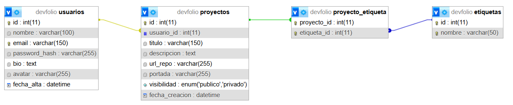

# Modelo de datos

La base de datos `devfolio` (MariaDB, cotejamiento `utf8mb4_unicode_ci`) tiene cuatro tablas. El script completo, con los datos iniciales, está en [`sql/schema.sql`](sql/schema.sql).



## Tablas

### `usuarios`

Personas registradas. Cada una tiene un perfil y un portfolio público.

| Campo | Tipo | Descripción |
|---|---|---|
| `id` | INT, PK, AUTO_INCREMENT | Identificador |
| `nombre` | VARCHAR(100), NOT NULL | Nombre que se muestra en el portfolio |
| `email` | VARCHAR(150), NOT NULL, UNIQUE | Email de acceso; no se puede repetir |
| `password_hash` | VARCHAR(255), NOT NULL | Contraseña cifrada con `password_hash()`; nunca se guarda en texto plano |
| `bio` | TEXT, NULL | Presentación breve del perfil |
| `avatar` | VARCHAR(255), NULL | Nombre del archivo de imagen guardado en `uploads/` |
| `fecha_alta` | DATETIME, NOT NULL | Fecha de registro (por defecto, la actual) |

### `proyectos`

Entidad principal de la aplicación. Cada proyecto pertenece a un usuario.

| Campo | Tipo | Descripción |
|---|---|---|
| `id` | INT, PK, AUTO_INCREMENT | Identificador |
| `usuario_id` | INT, NOT NULL, FK → `usuarios.id` | Autor del proyecto |
| `titulo` | VARCHAR(150), NOT NULL | Título |
| `descripcion` | TEXT, NOT NULL | Descripción del proyecto |
| `url_repo` | VARCHAR(255), NULL | Enlace al repositorio |
| `portada` | VARCHAR(255), NULL | Nombre del archivo de la portada guardado en `uploads/` |
| `visibilidad` | ENUM('publico', 'privado'), NOT NULL | `publico` lo ve cualquiera; `privado` solo su autor |
| `fecha_creacion` | DATETIME, NOT NULL | Fecha de creación (por defecto, la actual) |

### `etiquetas`

Catálogo fijo de etiquetas que se carga con el script (PHP, JavaScript, Java, HTML y CSS, Bases de datos, Diseño, Videojuegos).

| Campo | Tipo | Descripción |
|---|---|---|
| `id` | INT, PK, AUTO_INCREMENT | Identificador |
| `nombre` | VARCHAR(50), NOT NULL, UNIQUE | Nombre de la etiqueta; no se puede repetir |

### `proyecto_etiqueta`

Tabla intermedia que relaciona proyectos y etiquetas.

| Campo | Tipo | Descripción |
|---|---|---|
| `proyecto_id` | INT, FK → `proyectos.id` | Proyecto |
| `etiqueta_id` | INT, FK → `etiquetas.id` | Etiqueta |

La clave primaria es la pareja (`proyecto_id`, `etiqueta_id`), así un proyecto no puede tener la misma etiqueta dos veces.

## Relaciones

- **`usuarios` 1:N `proyectos`**: un usuario puede tener muchos proyectos y cada proyecto tiene un único autor.
- **`proyectos` N:M `etiquetas`**: un proyecto puede tener varias etiquetas y una etiqueta puede estar en muchos proyectos. Se resuelve con la tabla intermedia `proyecto_etiqueta`.

## Integridad

- **Claves foráneas** (motor InnoDB): no se puede crear un proyecto de un usuario que no existe ni asignar una etiqueta inexistente.
- **`ON DELETE CASCADE`**: si se borra un usuario se borran sus proyectos, y si se borra un proyecto se borran sus filas de `proyecto_etiqueta`. Así no quedan registros huérfanos.
- **`UNIQUE`** en `usuarios.email` y `etiquetas.nombre`.
- **`ENUM`** en `proyectos.visibilidad`: solo admite `publico` o `privado`.
- **`NOT NULL`** en los campos obligatorios.

## Regla de visibilidad

Las consultas de listado y detalle solo devuelven un proyecto si es público o si pertenece al usuario de la sesión:

```sql
SELECT * FROM proyectos
WHERE visibilidad = 'publico' OR usuario_id = :usuario_id
```

## Datos iniciales

| Usuario | Email | Proyectos |
|---|---|---|
| Lucía Martín | `lucia@devfolio.test` | 2 públicos, 1 privado |
| Carlos Ruiz | `carlos@devfolio.test` | 2 públicos, 1 privado |
| Marta Gómez | `marta@devfolio.test` | 1 público, 1 privado |
| Daniel Ríos | `daniel@devfolio.test` | — |
| Irene Pascual | `irene@devfolio.test` | — |
| Juan Carlos Macías | `juancarlos@devfolio.test` | — |

La contraseña inicial de todos es `Prueba123`.
